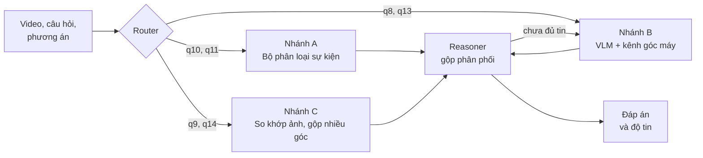

<div align="center">

# SVA: Soccer Video Agent

**Hệ hỏi đáp video bóng đá không cần huấn luyện, trao đổi bằng phân phối xác suất thay vì văn bản**


Nguyễn Phương Nam · Phạm Thị Hồng Hạnh · Giảng viên hướng dẫn: Dương Việt Hằng<br>
Trường Đại học Công nghệ Thông tin, ĐHQG-HCM

</div>

---

## Highlights

- **Mọi công cụ trả về phân phối xác suất trên đúng các phương án** của câu hỏi, không chốt một nhãn rồi viết
  thành chữ như SoccerAgent. Riêng thay đổi này đóng góp **5–19 điểm** ở 4/5 tác vụ áp dụng được.
- **Ba nhánh xử lý, mỗi nhánh một công cụ phù hợp**: so khớp ảnh cho replay, bộ phân loại sự kiện cho q10 và q11,
  VLM có thêm kênh góc máy cho q8 và q13, hỏi riêng từng góc quay rồi gộp bằng log pool cho q14.
- **Trên 2642 câu test**, SVA đạt **67.7%** (Qwen2.5-VL-3B) và **70.0%** (Qwen2.5-VL-7B). SoccerAgent dựng lại trên
  cùng mô hình đạt 44.7% và 48.1%. SVA hơn có ý nghĩa thống kê ở 5/6 và 6/6 tác vụ, và cao hơn cả Gemini hỏi thẳng
  (60.7%).
- **Độ tin đáng dùng**: khi chỉ trả lời 50% câu chắc nhất, SVA đúng 89.3% (ECE 0.030). Bản 3B chạy nhanh hơn
  SoccerAgent 10–30 lần.
- **Không huấn luyện, không tinh chỉnh.** Mọi tham số chọn trên tập dev; tập test chỉ dùng để chấm, mỗi cấu hình
  chạy một lần.

## Task

Hỏi đáp trắc nghiệm trên 6 tác vụ video của [SoccerBench](https://arxiv.org/abs/2505.03735). Tên file JSON của bộ dữ
liệu lệch một đơn vị so với ký hiệu trong bài báo (`q8.json` là Q7), nên trong code luôn dùng tên file.

| Mã | Bài báo | Tác vụ | Số câu | Sau làm sạch | Video mỗi câu |
|---|---|---|---:|---:|:---:|
| q8 | Q7 | Chuyển góc máy | 400 | 400 | 1 |
| q9 | Q8 | Tìm cảnh gốc của pha replay | 400 | 400 | 5 |
| q10 | Q9 | Phân loại sự kiện | 1000 | 1000 | 1 |
| q11 | Q10 | Chọn câu bình luận | 1000 | 1000 | 1 |
| q13 | Q12 | Màu áo của cầu thủ làm hành động | 700 | 700 | 1 |
| q14 | Q13 | Phạm lỗi quay từ nhiều góc | 300 | 276 | 2–4 |

Dữ liệu được chia theo nhóm nội dung (q14 theo pha phạm lỗi, q9 theo trận, các tác vụ khác theo file video) thành
**dev 1134 câu** và **test 2642 câu**, không nhóm nào nằm ở cả hai tập.

## Method



Mỗi công cụ trả về một **Evidence** `⟨type, K, p, c, o⟩`: phân phối `p` trên tập phương án `K`, độ tin `c` (hiệu hai
xác suất cao nhất) và quan sát gốc `o`. Phân phối từ VLM có được bằng cách chấm log-xác suất của từng mã phương án,
không để mô hình tự viết câu trả lời.

| Nhánh | Tác vụ | Cách làm |
|---|---|---|
| A | q10, q11 | Bộ phân loại sự kiện của UniSoccer cho phân phối 23 loại. q10 lấy xác suất của đúng các loại có trong phương án. q11 so loại sự kiện giữa video và từng câu bình luận. |
| B | q8, q13 | Một lượt VLM với mọi phương án. q8 thêm kênh góc máy: chấm 13 loại góc máy ở đầu và cuối clip, điểm của "From X to Y" là `log P(đầu=X) + log P(cuối=Y)`. q13 thêm một câu gợi ý. |
| C | q9 | CLIP ViT-L/14, 24 frame mỗi clip: mỗi frame replay tìm frame giống nhất trong ứng viên, lấy trung bình. Không dùng VLM. |
| C | q14 | Hỏi VLM riêng từng góc quay, gộp bằng log pool trọng số đều. |

**Reasoner** lấy trung bình các phân phối. Nếu độ tin dưới ngưỡng θ, nó chọn thêm một trong ba hành động: hỏi lại với
thứ tự phương án đảo ngược, hỏi riêng hai phương án dẫn đầu, hoặc hỏi lại với gấp đôi số frame. Vòng lặp này chỉ bật
ở q8 và q13; ở các tác vụ khác, thêm bằng chứng từ VLM làm kết quả giảm trên dev.

## Results

### Main results (test, 2642 câu, độ chính xác %)

| Tác vụ | B0-3B | B1-3B | **SVA-3B** | B0-7B | B1-7B | **SVA-7B** | Gemini |
|---|---:|---:|---:|---:|---:|---:|---:|
| q8 góc máy | 45.4 | 45.0 | 58.9 | 54.3 | 52.5 | **69.3** | 68.9 |
| q9 replay | 27.5 | 25.7 | 78.9 | 24.3 | 23.6 | **78.9** | 32.5 |
| q10 sự kiện | 36.1 | 74.6 | 87.1 | 45.4 | 79.7 | **87.1** | 64.4 |
| q11 bình luận | 31.3 | 31.4 | 74.3 | 44.6 | 37.0 | **72.0** | 70.1 |
| q13 màu áo | 45.9 | 46.3 | 46.5 | 45.1 | 43.3 | 48.4 | **48.8** |
| q14 phạm lỗi | 56.8 | 45.3 | 60.4 | 63.0 | 52.6 | 64.1 | **79.2** |
| **Trung bình** | 40.5 | 44.7 | 67.7 | 46.1 | 48.1 | **70.0** | 60.7 |
| Bỏ q10, q11 | 43.9 | 40.6 | 61.2 | 46.7 | 43.0 | **65.2** | 57.3 |

- **B0**: hỏi thẳng Qwen2.5-VL. **B1**: SoccerAgent dựng lại từ mã nguồn gốc (giữ nguyên prompt và chuỗi công cụ),
  chạy trên cùng mô hình nền. **Gemini**: Gemini 3.5 Flash-Lite nhận cùng frame, chỉ để tham khảo.
- Kiểm định McNemar giữa SVA và B1: p < 0.05 ở 5/6 tác vụ với 3B (q13 ngang nhau) và 6/6 tác vụ với 7B.
- Bộ phân loại sự kiện của UniSoccer được huấn luyện trên SoccerReplay-1988, cũng là nguồn clip của q10 và q11. Vì
  vậy luôn có thêm dòng trung bình bỏ hai tác vụ này.

### Ablation: giữ phân phối so với chốt nhãn (A1)

Giữ nguyên công cụ, chỉ thu phân phối của mỗi công cụ về nhãn cao nhất:

| Tác vụ | 3B: phân phối → nhãn | 7B: phân phối → nhãn |
|---|---|---|
| q8 | 56.4 → 45.7 (p = 0.004) | 66.1 → 55.0 (p = 0.002) |
| q9 | 78.9 → 73.9 (p = 0.007) | 78.9 → 72.9 (p = 0.002) |
| q10 | 87.1 → 71.9 (p < 0.001) | 87.1 → 71.3 (p < 0.001) |
| q11 | 74.3 → 56.0 (p < 0.001) | 72.0 → 52.7 (p < 0.001) |
| q14 | 60.4 → 60.9 (p = 1.0) | 64.1 → 65.6 (p = 0.63) |

Với mô hình 7B, để VLM mô tả video bằng chữ rồi mới chọn (cách SoccerAgent dùng VLM) cũng làm q8 giảm 7.5 điểm
(p = 0.044). Ở bản 3B thì không có khác biệt.

### Calibration và chi phí

| Hệ | Đúng khi trả lời 50% câu chắc nhất | AURC ↓ | ECE ↓ | Thời gian mỗi câu |
|---|---:|---:|---:|---|
| B0-3B | 44.2 | 0.536 | 0.045 | |
| B1-3B | 59.1 | 0.425 | 0.162 | 24–117 s (RTX 3050) |
| Gemini | 76.3 | 0.278 | 0.046 | API |
| **SVA-3B** | **89.3** | **0.120** | **0.030** | ≤ 5.5 s (RTX 3050) |
| B1-7B | 63.1 | 0.360 | 0.165 | 7–28 s (H200) |
| **SVA-7B** | **88.4** | **0.118** | 0.033 | ≤ 1.2 s (H200) |

### Phát hiện về SoccerBench

- **Lỗi nhãn**: ở q14, 31/300 câu có mã đáp án trỏ tới phương án không tồn tại. 7 câu sửa được, 24 câu bị loại.
  Ở q13 có 1 câu mã đáp án trỏ nhầm.
- **Clip lưu sai tỉ lệ**: 1200 clip của q10, q11 và q13 là hình ngang 398×224 bị ép thành 224×398. Code kéo chúng về
  đúng tỉ lệ trước khi dùng.
- **Thiên lệch nhãn ở q14**: một hệ không xem video, chỉ chọn nhãn phổ biến nhất của mỗi loại câu hỏi (đếm trên dev),
  đạt **87.0%** trên test, cao hơn mọi hệ có xem video.

Toàn bộ bảng nằm ở [`results/tables/`](results/tables/). File có hậu tố `_7b` là bản 7B.

## Installation

```bash
git clone https://github.com/NamPhuong550805/soccer-video-agent.git
cd soccer-video-agent
pip install -e ".[dev]"            # thêm ".[api]" nếu chạy Gemini
```

- **Dữ liệu**: đặt SoccerBench vào `data/raw/datasets/SoccerBench/` (gồm `qa/` và `materials/`). Dữ liệu không nằm
  trong repo.
- **B1 và nhánh A** cần code gốc SoccerAgent và checkpoint bộ phân loại sự kiện của UniSoccer trong `external/`:

```bash
git clone https://github.com/jyrao/SoccerAgent external/SoccerAgent
git -C external/SoccerAgent checkout 763c254     # bản đã dùng
huggingface-cli download Homie0609/UniSoccer pretrained_classification.pth --local-dir external/unisoccer
```

- **Gemini** cần file `.env` ở thư mục gốc với dòng `GOOGLE_API_KEY=...`.
- **GPU 4 GB** dùng cấu hình `qwen_local_3b` (Qwen2.5-VL-3B 4-bit, mặc định của các script). Nếu tải mô hình bị treo,
  đặt `HF_HUB_DISABLE_XET=1`.

## Reproduce

```bash
# 1. Dữ liệu: kiểm tra, kiểm toán nhãn, làm sạch, chia dev / test
python scripts/01_data.py all

# 2. Tính trước frame, embedding q9, phân phối của bộ phân loại sự kiện
python scripts/02_warm_cache.py --task all
python scripts/02_warm_cache.py --task q9 --encoder clip_vit_l --n-frames 24
python scripts/02_warm_cache.py --task q10 q11 --unisoccer

# 3. Baseline
python scripts/03_run.py --system b0_local --task all
python scripts/03_run.py --system b0_api --task all --workers 4
python scripts/03_run.py --system b1_vanilla --task all
python scripts/03_run.py --system b0_loop_trace --theta 1.0 --split dev --task all
python scripts/03_run.py --system b0_loop --theta auto --task all

# 4. Chọn cấu hình các nhánh trên dev
python scripts/04_dev_tuning.py q9
python scripts/04_dev_tuning.py q14
python scripts/04_dev_tuning.py branch_a

# 5. SVA: chọn theta trên dev rồi chạy test
python scripts/03_run.py --system sva_trace --theta 1.0 --split dev --task all
python scripts/03_run.py --system sva --theta auto --task all
python scripts/03_run.py --system sva_noloop --theta 0 --task all

# 6. Bảng kết quả và ablation
python scripts/05_report.py main
python scripts/06_ablation.py q9
python scripts/06_ablation.py a5
python scripts/06_ablation.py table

# 7. Bản agent cho video thật
python scripts/03_run.py --system sva_agent --theta 0.2 --task all
python scripts/03_run.py --system sva_agent_open --theta 0.2 --task all
python scripts/07_agent.py router        # còn có: paraphrase, open, long, format, abstain, policy, table

pytest tests
```

Muốn chạy bản 7B, thêm `--backend qwen_local` vào các lệnh trên; kết quả sẽ có hậu tố `_7b`. Trên server Slurm dùng
`sbatch scripts/hpc/job.sh scripts/03_run.py ...`. Mỗi lần chạy ghi log vào `logs/` và thêm một dòng vào
[`results/RUNS.md`](results/RUNS.md) gồm lệnh, commit, kết quả và thời gian chạy.

## Ask About Your Own Video

Bản agent tự nhận loại câu hỏi, tự tìm đoạn video liên quan và nhận video có độ dài, fps và kích thước bất kỳ. Câu hỏi
viết bằng tiếng Anh, có 2–4 phương án hoặc không có phương án (khi đó agent tự tạo ứng viên).

```bash
python scripts/07_agent.py ask --video highlight.mp4 --question "What happens at 1:10?"
python scripts/07_agent.py ask --video highlight.mp4 --question "Which earlier play is shown again in the replay at 2:40?"
python scripts/07_agent.py ask --video main.mp4 closeup.mp4 --question "Did the foul involve a handball?" --options No Yes
```

Kết quả với bản 3B ([`results/tables/agent_test.md`](results/tables/agent_test.md)):
- Khi giấu mã tác vụ, agent vẫn cho cùng câu trả lời như SVA biết tác vụ ở cả 2642 câu.
- Router chọn đúng nhánh ở 100% số câu.
- Trên video dài ghép từ các clip test, agent đạt 62.4%, so với 63.1% trên clip cắt sẵn.
- Với ngưỡng từ chối 0.527, agent trả lời 65.5% số câu và đúng 82.5% trong số đó.

Giới hạn: q9 trên video dài cần mốc thời gian của pha replay; video dọc 9:16 làm q10 giảm mạnh.

## Project Structure

```
configs/
  default.yaml      siêu tham số (chọn trên dev, có ghi chú số liệu)
  models.yaml       VLM (3B / 7B / Gemini), encoder ảnh, bộ phân loại sự kiện của UniSoccer
src/sva/
  config.py         đường dẫn, bảng tác vụ, lỗi nhãn đã biết; đọc YAML; log và sổ tay chạy
  data.py           Sample; đọc JSON gốc, kiểm toán nhãn, làm sạch, chia dev / test
  perception.py     đọc video, lấy frame theo thời gian, cache frame / embedding, encoder ảnh
  models.py         logprob -> phân phối; Qwen2.5-VL chạy tại chỗ; bộ phân loại sự kiện của UniSoccer
  evidence.py       Evidence (phân phối trên các phương án) và các cách gộp
  baselines.py      B0 (Qwen hỏi thẳng), Gemini
  b1.py             B1: dựng lại SoccerAgent (bộ công cụ và vòng thực thi của code gốc)
  branches.py       nhánh A (q10, q11), B (q8, q13), C (q9 so khớp replay, q14 nhiều góc quay)
  reasoner.py       Reasoner: gộp bằng chứng, chưa đủ tin thì hỏi thêm
  pipeline.py       Router và SVA
  eval.py           metric, McNemar, chạy hệ thống, đọc / ghi kết quả
  agent.py          bản agent cho video và câu hỏi thật
scripts/            01 → 07 theo thứ tự chạy; hpc/ cho server Slurm
notebooks/          01 → 07 trình bày kết quả (02 và 07 chạy mô hình thật, cần GPU)
tests/              pytest
results/            predictions/, tables/, dev/, ablation/, agent/, RUNS.md
```

| Notebook | Nội dung |
|---|---|
| `01_data` | Dữ liệu thô, lỗi nhãn, làm sạch, chia dev / test, lấy frame, cache |
| `02_evidence_scoring` | Chấm phân phối bằng Qwen2.5-VL, nhiệt độ, các loại Evidence (cần GPU) |
| `03_baselines` | B0 trên test, độ tin, thiên lệch vị trí, vòng lặp hỏi thêm |
| `04_branches` | Nhánh C (q9, q14), nhánh A (q10, q11), SVA trên 6 tác vụ |
| `05_evaluation` | Kết quả chính, ablation, calibration, chi phí, Gemini kết hợp SVA, phân tích ca, 3B so với 7B |
| `06_agent` | Đánh giá bản agent |
| `07_demo` | Chạy thử một câu bất kỳ, câu hỏi mở, video dài (cần GPU) |

## Limitations

- q13 (màu áo) không cải thiện: mọi hệ, kể cả Gemini, chỉ đạt 43–49%.
- Ở q14, SVA hơn B1 nhưng chưa hơn B0 có ý nghĩa, và thua mốc không xem video.
- B1 dùng Qwen2.5-VL thay cho DeepSeek-V3, GPT-4o và MatchVoice của hệ gốc, nên chưa khẳng định được SVA tốt hơn
  SoccerAgent bản đầy đủ.

## Acknowledgements

Dự án dùng bộ dữ liệu SoccerBench và mã nguồn của [SoccerAgent](https://github.com/jyrao/SoccerAgent), bộ phân loại sự
kiện của [UniSoccer](https://huggingface.co/Homie0609/UniSoccer), mô hình
[Qwen2.5-VL](https://github.com/QwenLM/Qwen2.5-VL) và [CLIP](https://github.com/openai/CLIP).

Nếu dùng SoccerBench, hãy trích dẫn bài báo gốc:

```bibtex
@inproceedings{rao2025socceragent,
  title     = {Multi-Agent System for Comprehensive Soccer Understanding},
  author    = {Rao, Jiayuan and Li, Zifeng and Wu, Haoning and Zhang, Ya and Wang, Yanfeng and Xie, Weidi},
  booktitle = {Proceedings of the 33rd ACM International Conference on Multimedia},
  year      = {2025}
}
```
